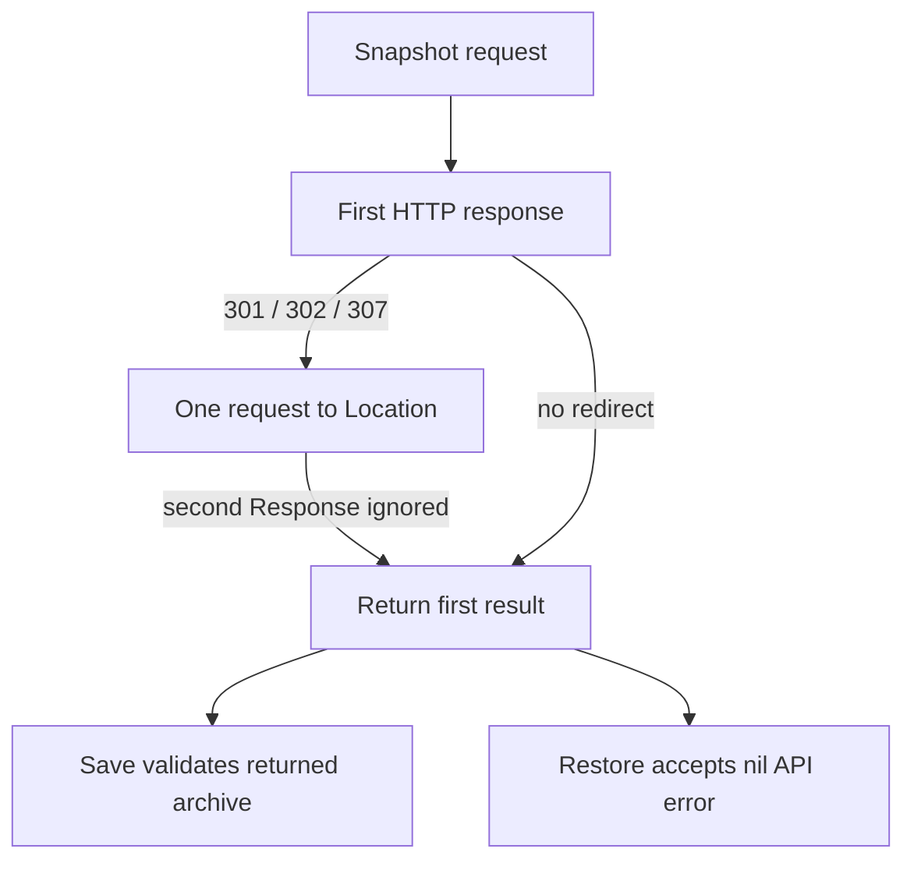

# CLI B04/B05: source map before report attribution

This is a static map for the one current CLI job `desktop/1a1aee01612-fc05-639b`. The job is known to have ended with exit 1, full durable output, and producer-reported B04/B05 failures. Its 848,065-byte public report has been identified but **has not yet been read**. This packet does not assign the failures to a root cause, qualify B01–B03, change product code, or authorize another run.

## Exact source and predicates

The official source is OpenBao v2.7.1, tag commit `a5db72cef75c24b920ade02065b18dd8eb666bac`. Current product code is `4e808d0ecb1bcded22870a7ec960dfb2491cf6ec`, tree `eba5e650bd080b8ad41ea52a2bc68867f541d255`. SOURCE-INDEX gives whole bytes/SHA256/Git IDs and primary URLs. The four immediate canonical trees and selected product membership are independently rehashed; this is not a new full-regression qualification.

| Case | Actual fixture source contract | Still needed from the original report |
|---|---|---|
| B04 | One default official CLI save directed to an observed standby. Qualification requires CLI exit 0, a valid saved archive, known terminal audit status 200, and complete request/response pairing. | CLI exit/error class, output identity/archive checks, target/leader and exact audit statuses. |
| B05 | One default restore to an observed standby using **the separately verified B03 leader archive**, after a single CAS mutation to version 3. Qualification requires CLI exit 0, terminal 200/204 and exact baseline restored on all nodes. | Archive input stability, actual terminal status, restored vs unchanged state, all-node versions/values/metadata, cold result and cleanup. |

A terminal 400/403 with exact unchanged pre-restore mutated state is a known rejection and remains unqualified. Cold restart in that branch verifies the actual unchanged state; it cannot convert rejection into restore success. The controller explicitly records that HTTP framing is not observed. Neither case uses `-force`, manual redirect handling, a retry, or a failed B04 archive as B05 input. [actual-controller.py:654–816,870–892]

## Official client's relevant static behavior

Both snapshot operations use `httpRequestWithContext`, not the separate retryable request helper. The default HTTP client returns redirect responses to this explicit handler. [official-api-client.go:375–385,1637–1760]

The source assigns `result` from the first response, updates `req.URL`, calls `ResetJSONBody`, then executes a second `Do(req)` while discarding that second response. The final status check and return still use the first result. The response error helper accepts status 200 through 399. These are source facts, not yet an explanation of this job. [official-api-client.go:1713–1760; official-api-response.go:28–36]

Save copies the returned response body and independently requires a nonempty `SHA256SUMS.sealed` member in gzip/tar. Restore wraps the open file reader in `io.NopCloser`; `ResetJSONBody` returns without resetting anything when `BodyBytes` is nil. The displayed redirect branch does not seek that file or replace `req.Body`. This establishes a body-replay question, not how many bytes were actually consumed in this run. [official-api-raft.go:169–266; official-api-request.go:59–65]

The restore `force` flag defaults to false. It changes the selected route to `snapshot-force` and is documented as bypassing snapshot seal-key consistency checks. It uses the same HTTP request helper. It is not a proposed workaround here. [official-restore.go:42–53,89–112; official-api-raft.go:250–265]

## Current standby boundary

The native snapshot service checks the configured current leader before authentication/token-use persistence, snapshot staging and ordinary JSON HA forwarding. On a known standby it records request/307 response audit events and returns a trusted leader origin. Missing leader/route or failed audit gives a failure response. [current-snapshot-transfer.rs:374–485]

The native HTTP adapter returns `307 Temporary Redirect` with the trusted origin plus the checked original target and `Content-Length: 0`. That redirect branch does not allocate a snapshot spool or carry the archive through the ordinary bounded JSON HA forwarding frame. This is an existing deliberate boundary, also asserted by existing source tests; those tests were not executed for this map. [current-http-snapshot.rs:99–140,338–379; current-snapshot-redirect-tests.rs:40–89]

HTTP/2 first collects the bounded incoming body, then invokes the shared parsed-request/service path and serializes the same NativeReply. Therefore the HTTP/1 adapter's unread-upload comment must not be promoted to a claim about the actual CLI's negotiated ALPN or consumed upload bytes. The separate explicit-H2 qualification does not identify this CLI request's protocol. [current-http-h2.rs:201–283,356–395]

## Questions to resolve from the original public report

- If B04 has standby 307 then leader 200 with CLI `incomplete_snapshot` and invalid/empty output, compare that conjunction with the first-response return path above. Do not assume the conjunction.
- If B05 has standby 307 then terminal 400/403 and the mutated state is unchanged, first preserve it as a known rejection. Then compare actual process classification and input stability with the response-selection/body-reset code.
- Preserve unknown Location values, ALPN and raw framing when the report lacks explicit observations. Audit status pairing does not manufacture these fields.
- Read individual owned-process/FD cleanup and input fences before claiming the complete fixture closed correctly.

No private CLI stderr body, alternate endpoint, new flag, replay, enlarged budget or product change is included. The old B01 UNKNOWN and old Git archival UNKNOWN remain separate historical records. PROBLEM-MAP and ANCHORS contain the exact source relationships for subsequent evidence-based repair.
